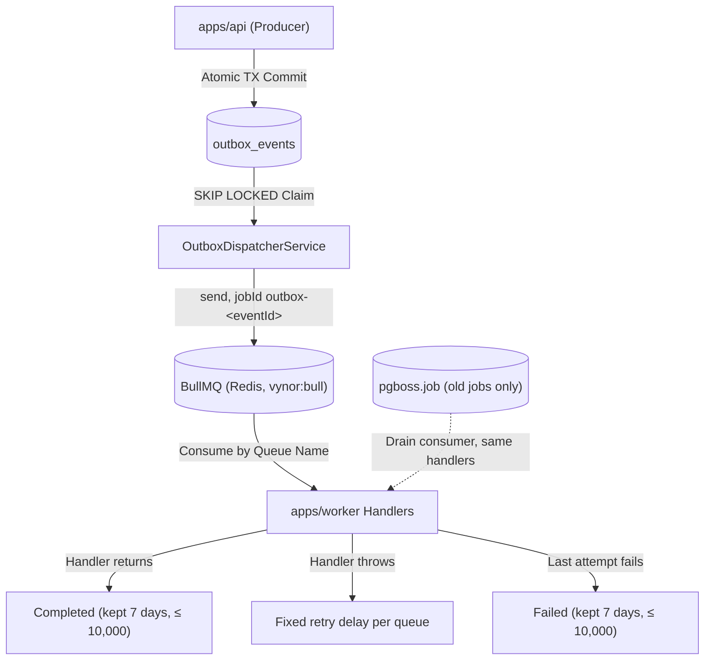
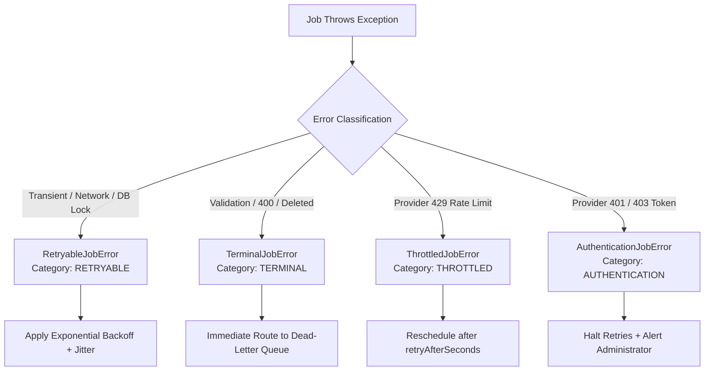

# Background Jobs, Queue Conventions & Failure Governance

This document describes the background job architecture of VYNOR CRM: the transport (BullMQ on Redis since WU-05a, with `pg-boss` draining jobs from before the cutover), the named queue taxonomy, the versioned job envelope, failure classification, retry policy, dead-letter operations, worker lifecycle, and the runbooks for the queue (conforming to **FND-051** through **FND-055** and **FND-060**, [AD-015](adr/0015-bullmq-job-transport.md)).

---

## 1. Queue Architecture (FND-051, AD-015)

Conforming to **AD-001** and **AD-015**, background jobs run inside `apps/worker`. The PostgreSQL outbox stays the source of truth (AD-006); BullMQ on Redis is the transport. During the WU-05a expand phase, `pg-boss` only drains jobs enqueued before the cutover; WU-05b removes it.



- **Transport token:** the dispatcher, both consumers and the heartbeat inject `JobQueue` (`apps/worker/src/queue/job-queue.ts`). `QueueModule` binds it to `DrainingJobQueue`: sends go to `BullMqJobQueue`; `work()` registers the same handler on BullMQ and on `PgBossService`.
- **Redis:** `REDIS_URL` is required by the worker (no in-process fallback). The compose `redis` service (AOF `everysec`, `noeviction`, password, no published port) serves the API's shared state and the job queues.
- **Job ID:** `outbox-<eventId>` (`outboxJobKey`). BullMQ does not add a second job under an ID it still holds (waiting, delayed, active, or kept after finishing). pg-boss's `singletonKey` never deduplicated on its standard-policy queues (NF-15).

### 1.1 Named Queue Taxonomy

All queue names are namespaced under `vynor.<domain>.<action>` (`QUEUE_NAMES`). The outbox only produces `webhook.received` (to `vynor.webhooks.process`) and `message.outbound.requested` (to `vynor.messages.outbound`); the other queues have no producer yet.

| Queue Name                            | Default Concurrency | Attempts | Retry Delay (fixed) | Purpose                                                         |
| :------------------------------------ | :------------------ | :------- | :------------------ | :-------------------------------------------------------------- |
| **`vynor.messages.outbound`**         | 10                  | 6        | 5 s                 | Delivering outbound messages via external channel adapters      |
| **`vynor.webhooks.process`**          | 20                  | 6        | 2 s                 | Asynchronous parsing and ingestion of journaled provider events |
| **`vynor.campaigns.dispatch`**        | 5                   | 4        | 15 s                | Broadcast campaign batch scheduling and recipient dispatch      |
| **`vynor.conversations.route`**       | 10                  | 4        | 3 s                 | AI assignment and skill-based agent routing                     |
| **`vynor.ai.generate`**               | 5                   | 4        | 5 s                 | RAG retrieval, prompt assembly, and LLM completions             |
| **`vynor.audit.export`**              | 2                   | 4        | 30 s                | Compliance audit log CSV/JSON exports                           |
| **`vynor.maintenance.outbox-prune`**  | 1                   | 3        | 60 s                | Scheduled deletion of aged, completed outbox rows               |
| **`vynor.maintenance.lease-recover`** | 1                   | 3        | 10 s                | Periodic recovery of expired worker leases                      |

Attempts are `retryLimit + 1` from `QUEUE_CONFIGS` (pg-boss counted retries after the first attempt; BullMQ counts every attempt). Finished jobs are kept 7 days, as pg-boss deleted them by default, and at most 10,000 per queue and state, so they cannot fill Redis. `QUEUE_CONFIGS.retentionDays` was never applied by pg-boss and is still unused.

---

## 2. Versioned Job Envelope Contract (FND-052)

Every background job is wrapped in a strongly-typed, versioned envelope (`JobEnvelopeSchema`):

```typescript
export interface JobEnvelope<T = Record<string, unknown>> {
  jobId: string; // Unique job identifier (UUIDv7)
  queue: QueueName; // Target queue
  version: number; // Schema version (default: 1)
  context: EventContext; // Correlation, causation, workspace, and actor context
  attempt: number; // Current attempt count (1-indexed)
  maxAttempts: number; // Maximum allocated attempts
  enqueuedAt: string; // ISO 8601 UTC timestamp
  payload: T; // Strongly-typed domain payload
}
```

---

## 3. Failure Classification Hierarchy (FND-053)

To avoid naive retry loops on invalid data or unauthenticated credentials, failures are categorized into four explicit classes:



### 3.1 Failure Classes

1. **`RetryableJobError`:** Transient network glitches, 503 Service Unavailable, and database serialization conflicts (`40001`). Safe to retry.
2. **`TerminalJobError`:** Schema validation failures, malformed JSON, or references to deleted entities. Immediately routed to DLQ without wasting compute.
3. **`ThrottledJobError`:** External API rate limit exceeded (HTTP 429). Postpones retry by `retryAfterSeconds`.
4. **`AuthenticationJobError`:** Provider API key revoked or OAuth token expired. Halts retries to prevent account lockout until token refresh occurs.

---

## 4. Retry Policy (FND-054)

**Job processing (owner decision Q-05A-2):** a handler that throws is retried after the queue's **fixed** `retryDelaySeconds`, up to `retryLimit` retries, exactly as pg-boss ran it (`jobOptionsFor` in `bullmq-job-queue.ts`). The handler receives `retryCount` (failed attempts so far, BullMQ `attemptsMade`) and `retryLimit`, so the last attempt has `retryCount === retryLimit`. Moving job retries to exponential backoff is a follow-up target once the expand phase is stable; it is not part of WU-05a.

**Transport start:** a failed BullMQ or pg-boss start is retried exponentially (5 s, ×2, max 60 s), see §6.3.

`DEFAULT_JOB_RETRY_POLICY` and `calculateJobRetryDelay` (full-jitter exponential, below) are contracts for that follow-up and are not applied to job processing today:

$$\text{BaseDelay} = \min\left(\text{maxDelaySeconds},\; \text{initialDelaySeconds} \times \text{backoffFactor}^{(\text{attempt} - 1)}\right)$$

$$\text{ActualDelay} = \text{BaseDelay} \times \left(0.5 + 0.5 \times \text{random}()\right)$$

- **`maxAttempts`:** 5
- **`initialDelaySeconds`:** 5 seconds
- **`backoffFactor`:** 2
- **`maxDelaySeconds`:** 300 seconds (5 minutes)
- **`timeoutSeconds`:** 60 seconds

---

## 5. Dead-Letter Queue (DLQ) Operations (FND-055)

When a job exceeds `maxAttempts` or encounters a `TerminalJobError`, it transitions to `DEAD_LETTER`.

### DLQ Governance Operations

1. **Inspection (`DeadLetterQuery`):** Query dead-letter items filtered by `workspaceId`, `queue`, and `eventType`.
2. **Retry (`RETRY`):** Reset attempt count to 0, update `scheduledAt` to now, and reset status to `PENDING`.
3. **Replay (`REPLAY`):** Bulk re-dispatch of dead-letter jobs matching a specific error code or affected provider window.
4. **Abandon (`ABANDON`):** Mark permanently discarded with audit logging of the administrator reason.

---

## 6. Worker Lifecycle & Heartbeat Governance (FND-060)

### 6.1 Graceful Shutdown Protocol

When `SIGTERM` or `SIGINT` is received:

1. The outbox dispatcher stops claiming and waits (up to 3 s) for a running cycle; claimed events it did not hand over go back to `PENDING` without using an attempt.
2. `BullMqJobQueue.onModuleDestroy` cancels a pending start retry and the Redis probe; from here `isRunning()` is `false`, so nothing more is sent.
3. `beforeApplicationShutdown` (after every module stopped): each BullMQ worker stops fetching and waits up to 15 s for its active jobs; a worker still busy then has its connections closed, and its jobs run again once their lock lapses. Then the queues and the producer connection close. `PgBossService` stops gracefully (15 s) in parallel.
4. No Redis connection or timer is left behind.

### 6.2 Job Locks, Stalled Jobs & Lease Recovery

- An active BullMQ job holds a 30 s lock that the worker renews while the handler runs. If the worker dies (OOM, container kill), another worker moves the job back to waiting after the lock lapses and runs it again; this does not count as a failed attempt. A job that stalls more than `retryLimit` times fails instead of looping (pg-boss retried an expired job up to its retry limit).
- If a worker crashes while it holds outbox leases, `recoverExpiredOutboxLeases` returns rows whose `claim_lease_expires_at < NOW()` to `PENDING` (one attempt used); the re-dispatch finds the job BullMQ already holds under `outbox-<eventId>`.

### 6.3 Failed Queue Start & In-Process Retry (NF-02)

Boot waits for the first start attempt only, for BullMQ and for pg-boss alike. An attempt fails when it is refused (e.g. Redis or the database is not accepting connections yet) or has not finished within 30 s (`DEFAULT_BULLMQ_TIMINGS.startTimeoutMs`, `PG_BOSS_START_TIMEOUT_MS`, e.g. a connection that hangs). After a failure the worker keeps booting and retries in the background with a new connection or instance: 5 s after the first failure, doubling up to 60 s, until a start succeeds or the worker shuts down. Each failure logs an `error` (`correlationId: 'queue_init'`, `transport`) with the `attempt` number and `retryInMs`.

- **While BullMQ is not running** (not started, Redis down, or Redis hung: a PING every 5 s times out after 2 s): `isRunning()` is `false`, `send()` throws at once (the producer connection has no offline queue), the dispatcher leaves events `PENDING` without claiming them, and the heartbeat is skipped, so the container turns `unhealthy`. Once Redis answers again, all of it resumes without a restart; the consumers reconnect on their own.
- **Handlers:** a `work()` call made before the start is kept and registered once a start succeeds, exactly once per queue (`correlationId: 'queue_work_deferred'`, then `'queue_work_registered'`). BullMQ's reconnects never add a second consumer.
- **Timed-out attempt:** its connection (or pg-boss instance) is closed without waiting for it, so it cannot keep running in the background.
- **Shutdown:** `onModuleDestroy` cancels the pending retry. An attempt still in flight closes its own connection once it finishes, so shutdown does not wait for it.

### 6.4 Dual Transport and the pg-boss Drain (WU-05a, owner decision Q-05A-1)

- The heartbeat requires a database ping and a running BullMQ. A pg-boss drain that cannot start does **not** stop it (DEGRADED): `PgBossService` keeps retrying its start, and `PgBossDrainMonitor` logs `pg-boss drain DEGRADED` (`correlationId: 'pgboss_drain'`, with the backlog) when it begins and every 5 minutes while it lasts.
- Every minute the monitor counts unfinished pg-boss jobs (`created`, `retry`, `active`) per queue next to the BullMQ backlog (`waiting`, `active`, `delayed`, `failed`) and logs when it changes (`pg-boss drain in progress`). It logs `pg-boss drain complete` only when that count succeeded and returned zero; a count that fails is logged as `drain status unknown`, never as complete. The WU-05b gate still requires the count per environment (07 §8.3).

---

## 7. Runbook: Outbox COMPLETED but the BullMQ Job Is Lost (VYN-05A-03, 07 §8.2)

Redis persists with AOF `everysec`, so a crash can lose up to a second of writes: the outbox may have committed `COMPLETED` for a job Redis no longer has. `OutboxReconciliationService` checks every 5 minutes (read-only) for events that:

- are `COMPLETED`, handed over between 10 minutes and 24 hours ago,
- still have their work pending (07 §4.1 conditions: provider event `RECEIVED`/`PROCESSING`, or outbound message `PENDING`),
- and have no job under `outbox-<eventId>` in BullMQ (in any state).

It logs an `error` (`correlationId: 'outbox_reconciliation'`) listing them, with `replay: 'safe'` for inbound events (ingest is idempotent) and `replay: 'review'` for outbound replies (a provider may have accepted a send whose result was lost). Nothing is changed automatically, in any environment.

Operator steps:

1. Take a read-only snapshot of the listed `outbox_events`, `provider_events`, `messages` and the queue counts; record it in 08/09.
2. For `review` items, check the provider (message ID, delivery receipts) before replaying; replaying an outbound reply that the provider did accept sends it twice.
3. Run the 07 §4.1 `UPDATE` as a `SELECT` first, limited to the approved IDs (`AND id = ANY(:ids)`). Only in a sandbox database without further approval; any other database needs owner/DBA approval at that time (GATE-ENV).
4. The dispatcher re-dispatches the rows; confirm the domain state (provider events `PROCESSED`, replies `SENT`) and that the alert clears.

---

## 8. Delivery Guarantees, Ordering & Recovery

- **At least once.** A job can run more than once: after a worker dies mid-job (stalled), after an outbox re-dispatch whose job was already removed, or after a manual replay. Handlers are idempotent on domain state (AD-005): inbound ingest skips processed events and deduplicates messages by provider message ID; outbound only sends replies still `PENDING`.
- **Not exactly once towards providers.** The outbound handler reads `PENDING`, calls the provider, then marks `SENT`. If it dies between the provider call and that update, the retry sends again. The idempotency key passed to the adapter only helps where the provider honours one; WhatsApp Cloud does not, so a duplicate send is possible in that window.
- **Ordering.** Jobs of a queue run concurrently (20 webhooks, 10 replies), as with pg-boss, so they do not run in arrival order. The conversation timeline is ordered by the provider timestamp, not by processing order (verified with 1,000 webhooks across 50 conversations).
- **Dispatch failures.** A send that fails or times out uses one outbox attempt (5 per event, then `DEAD_LETTER`). Events not yet sent in that cycle go back to `PENDING` unchanged. A timed-out add may still reach Redis; the next dispatch then finds that job and completes the event without a second job.
- **Rollback of WU-05a.** Revert the PR. Events already `COMPLETED` to BullMQ whose work is still pending can be returned to `PENDING` with the 07 §4.1 query (from the cutover time), so the restored pg-boss dispatcher takes them; handlers turn already-processed events into no-ops.

---

## 9. pg-boss ↔ BullMQ Behaviour Matrix (WU-05a)

| Behaviour                       | pg-boss (baseline `69fd238`/`b418354`)                           | BullMQ (WU-05a)                                                                      | Verified by                                                           |
| ------------------------------- | ---------------------------------------------------------------- | ------------------------------------------------------------------------------------ | --------------------------------------------------------------------- |
| Attempts                        | `retryLimit` retries after the first attempt (6 in total)        | `attempts = retryLimit + 1` (6)                                                      | `bullmq-job-queue` (6 runs, `retryCount` 0–5)                         |
| Retry delay                     | Fixed `retryDelaySeconds` (no `retryBackoff`)                    | `backoff: fixed`, same delay                                                         | `bullmq-job-queue` (≥ 2 s apart on webhooks), stored job options      |
| Last attempt flag               | `retryCount >= retryLimit`                                       | `attemptsMade >= attempts - 1`, same fields                                          | `bullmq-job-queue`                                                    |
| Retry vs. permanent             | Handler throws to retry, returns when done or permanently failed | Same                                                                                 | `bullmq-job-queue`, E2E transient and permanent failure               |
| Deduplication                   | `singletonKey outbox:<id>`, ignored by standard queues (NF-15)   | Job ID `outbox-<id>`, deduplicated while the job is held                             | `bullmq-job-queue`, `pg-boss-drain` (NF-15), `bullmq-fault-injection` |
| Retention of finished jobs      | Deleted 7 days after finishing (pg-boss default)                 | 7 days, at most 10,000 per queue and state                                           | `bullmq-job-queue` (stored options)                                   |
| Worker died during a job        | Job expires after 15 min, retried as an attempt                  | Lock lapses after 30 s, job runs again, not counted; fails after `retryLimit` stalls | `bullmq-fault-injection` (killed child process)                       |
| Start retry and timeout (NF-02) | 5 s ×2 to 60 s; 30 s timeout; instance stopped                   | Same; connection closed                                                              | `bullmq-job-queue` (5 scenarios)                                      |
| Deferred `work()`               | Registered once after start                                      | Same; reconnects add no consumer                                                     | `bullmq-job-queue`                                                    |
| Send while down                 | `sendJob` throws                                                 | `send` throws; no offline queue                                                      | `bullmq-job-queue`, `outbox-dispatch-failures`                        |
| Heartbeat                       | DB ping and pg-boss running                                      | DB ping and BullMQ running (Redis answers); drain failure degraded only              | `pg-boss-drain`, `bullmq-fault-injection`, compose smoke              |
| Graceful shutdown               | `stop({ graceful, timeout: 15 s })`                              | `worker.close()` up to 15 s, then connections closed                                 | `bullmq-job-queue`                                                    |
| Job data in the database        | `pgboss.job`                                                     | None (Redis); outbox row unchanged                                                   | E2E golden path (no pg-boss job)                                      |
