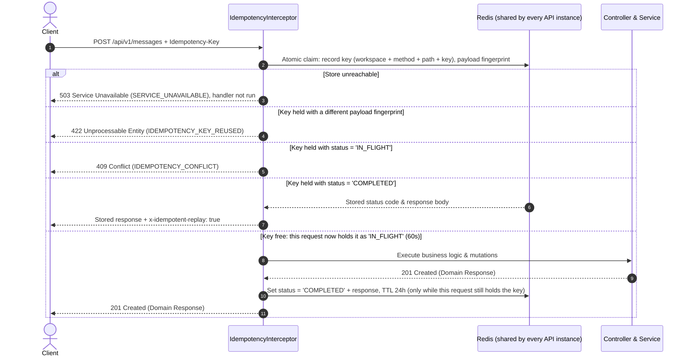

# Idempotency Policy & Replay Mechanics

This document establishes the official idempotency standards, header requirements, locking state machines, and replay behavior for mutating command endpoints across VYNOR CRM.

---

## 1. Overview & RFC Standard Compliance

Network retries, client double-clicks, and webhook delivery retries can cause non-idempotent operations (such as sending messages, launching campaigns, or billing transactions) to execute multiple times.

To guarantee that duplicate requests produce exactly one state mutation, VYNOR CRM implements the IETF Idempotency-Key HTTP header standard (`draft-ietf-httpapi-idempotency-key-header`).

---

## 2. Header Specification

Clients send the idempotency identifier in the `Idempotency-Key` header:

```http
POST /api/v1/messages HTTP/1.1
Host: api.vynor.local
Authorization: Bearer <token>
x-workspace-id: ws_12345
Idempotency-Key: 9b1deb4d-3b7d-4bad-9bdd-2b0d7b3dcb6d
Content-Type: application/json

{
  "conversationId": "conv_987",
  "text": "Your order has shipped."
}
```

### Constraints (`IdempotencyKeyHeaderSchema`)

- **Length:** Between 8 and 128 characters.
- **Allowed Characters:** Alphanumeric (`a-z`, `A-Z`, `0-9`), dashes (`-`), and underscores (`_`).
- **Uniqueness:** Generated by client (UUIDv4/UUIDv7 or unique CUID2).

---

## 3. Idempotency State Machine & Execution Flow



### 3.1 States

| State           | TTL / Timeout      | Behavior                                                                                                                        |
| :-------------- | :----------------- | :------------------------------------------------------------------------------------------------------------------------------ |
| **`IN_FLIGHT`** | `60 seconds`       | Distributed lock across API instances preventing concurrent execution of identical keys. Returns `409 Conflict`.                |
| **`COMPLETED`** | `24 hours`         | Request executed successfully. Subsequent requests with the same payload receive the identical stored status and response body. |
| **`FAILED`**    | Immediate eviction | If the handler throws an error, the key is released, permitting safe immediate retry by the client.                             |

### 3.2 Payload check (WU-04, closes NF-11)

The record keeps a SHA-256 fingerprint of the request's query and body, with object keys sorted, so
key order and whitespace do not matter. A repeat with the same key but another payload is refused
with `422 Unprocessable Entity` (`IDEMPOTENCY_KEY_REUSED`), as the IETF draft recommends, whether the
first request is still running or already completed. Clients must use a new key for a new request.

---

## 4. Replay Response Headers

When an idempotent replay occurs, the API returns the exact response body and status code generated by the original execution, accompanied by the tracking header:

```http
HTTP/1.1 201 Created
Content-Type: application/json
x-correlation-id: req_1727161200_a8f92b
x-idempotent-replay: true

{
  "data": {
    "id": "msg_01",
    "text": "Your order has shipped."
  }
}
```

---

## 5. Scope & Key Partitioning

Idempotency keys are partitioned by multi-tenant context to prevent cross-workspace key collisions:

$$\text{StorageKey} = \text{"vynor:idem:"} + \text{workspaceId} + \text{":"} + \text{SHA-256}(\text{HTTP\_Method} + \text{" "} + \text{Path} + \text{" "} + \text{IdempotencyKey})$$

This guarantees that:

1. Two different workspaces using identical UUIDs do not collide.
2. An idempotency key sent to `POST /api/v1/messages` cannot inadvertently suppress a request to `POST /api/v1/campaigns`.
3. No client key or identifier from the URL is stored in Redis in clear text.

The scope is the workspace, not the user: a colleague in the same workspace who reuses a key with the
same payload receives the stored response (NF-12, open in `docs/migration/08-migration-execution-log.md`).

---

## 6. Storage and Failure Modes (WU-04, DEC-04)

Records live in Redis (`REDIS_URL`), shared by every API instance, so a retry that reaches another
instance is replayed or refused exactly as on the first one. The claim, the completion and the release
each run as one Redis Lua script; completion and release only act while the request still holds its
claim, so a request that outlived its 60-second in-flight lock never overwrites a newer one.

| Situation                                     | Behavior                                                                                                             |
| :-------------------------------------------- | :------------------------------------------------------------------------------------------------------------------- |
| Redis unreachable when the request arrives    | Fail closed: `503 SERVICE_UNAVAILABLE`, the handler does not run. Readiness (`/api/v1/health/ready`) reports `DOWN`. |
| Redis lost after the handler ran              | The response is still returned; it is not stored, and repeats get `409` until the in-flight lock expires (60 s).     |
| Redis lost while releasing a failed request   | The error is returned; the key frees itself when the in-flight lock expires (60 s).                                  |
| Instance crashes mid-request                  | The in-flight lock expires after 60 s; a retry then runs again.                                                      |
| Redis full (`maxmemory`, policy `noeviction`) | Writes are refused, so keyed requests fail closed with `503`; no record is ever evicted silently.                    |
| Request without an `Idempotency-Key`          | Never touches Redis and is served even while Redis is down.                                                          |

Redis runs with AOF (`appendfsync everysec`): a crash can lose up to about one second of records. The
client fails fast instead of queueing commands while disconnected (2-second command timeout) and
reconnects in the background. `SHARED_STATE_STORE=memory` keeps records in the process instead; the
environment schema allows it only for a single local or test process, never in staging or production.
