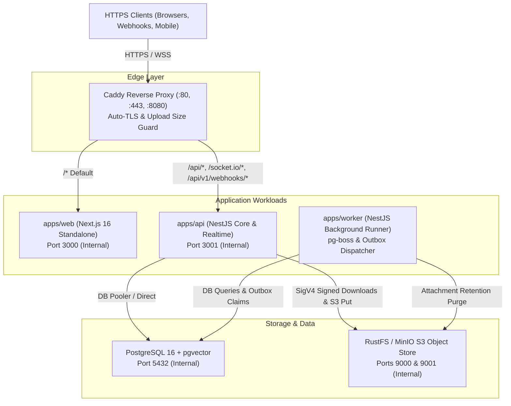
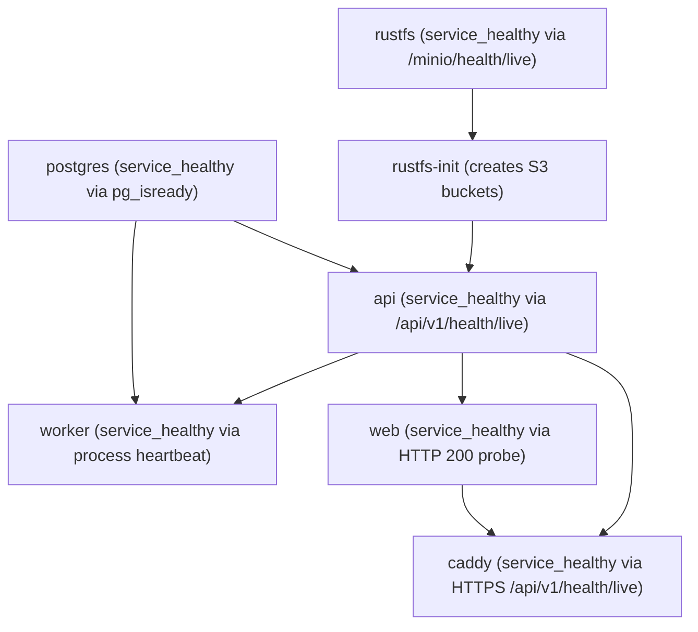

# Infrastructure & Deployment Guide

This document details the container architecture, Docker Compose service topology, edge reverse proxy configuration, health checks, and zero-sleep startup ordering for VYNOR CRM (**FND-INF-001 through FND-INF-005**).

---

## 1. System Topology Overview

VYNOR CRM runs as a modular monolith plus worker architecture backed by PostgreSQL, S3-compatible object storage (RustFS / MinIO), and edge routing via Caddy.



---

## 2. Service Catalog & Port Allocation

| Service       | Container Name      | Image / Build Context                                                | Exposed Ports                   | Internal Port | Description                                                                            |
| :------------ | :------------------ | :------------------------------------------------------------------- | :------------------------------ | :------------ | :------------------------------------------------------------------------------------- |
| `caddy`       | `vynor-caddy`       | `caddy:2.8-alpine`                                                   | `80:80`, `443:443`, `8080:8080` | `80, 443`     | Reverse proxy, TLS termination, request filtering.                                     |
| `web`         | `vynor-web`         | `infrastructure/docker/Dockerfile.web`                               | `3000:3000`                     | `3000`        | Next.js App Router standalone web shell.                                               |
| `api`         | `vynor-api`         | `infrastructure/docker/Dockerfile.api`                               | `3001:3001`                     | `3001`        | NestJS REST API, Webhooks, Socket.IO gateway.                                          |
| `worker`      | `vynor-worker`      | `infrastructure/docker/Dockerfile.worker`                            | None (Internal)                 | N/A           | pg-boss background jobs & transactional outbox dispatcher.                             |
| `postgres`    | `vynor-postgres`    | `pgvector/pgvector:pg16`                                             | `5432:5432`                     | `5432`        | Relational database with vector search extensions.                                     |
| `rustfs`      | `vynor-rustfs`      | `docker.io/pgsty/silo:RELEASE.2026-10-15T00-00-00Z@sha256:aaac6bce…` | `9000:9000`, `9001:9001`        | `9000, 9001`  | S3-compatible binary storage (PGSTY Silo, a MinIO fork) & console.                     |
| `rustfs-init` | `vynor-rustfs-init` | same Silo image (`mcli`)                                             | None                            | N/A           | One-shot job creating both storage buckets (idempotent, fails if a bucket is missing). |

Compose lives only at the repository root and the Dockerfiles only in `infrastructure/docker/` (DEC-08); `pnpm infra:verify` fails if a copy reappears. The build context is the repository root.

> **Storage image (WU-01, NF-08):** MinIO no longer publishes `minio/minio` or `minio/mc` (removed from Docker Hub; quay.io refuses anonymous pulls). On the owner's decision the stack uses PGSTY Silo, a MinIO fork with the same S3 API, `/minio/health/live`, `MINIO_ROOT_*` variables and `server` command, which also ships `mcli`. It is pinned in `x-storage-image` to the multi-arch index digest verified against Docker Hub (`linux/amd64` and `linux/arm64`); `pnpm infra:verify` fails on any other reference.

---

## 3. Health Checks & Zero-Sleep Startup Ordering (FND-INF-005)

Startup race conditions and flaky environments are eliminated by enforcing **explicit health check dependencies** (`condition: service_healthy`). No arbitrary `sleep` commands are used anywhere in the codebase or container entrypoints.

### Startup Dependency Chain



### Health Check Probes Definition

1. **PostgreSQL:**
   ```yaml
   healthcheck:
     test: ['CMD-SHELL', 'pg_isready -U postgres -d vynor']
     interval: 5s
     timeout: 5s
     retries: 5
     start_period: 10s
   ```
2. **RustFS / S3 Object Store:**
   ```yaml
   healthcheck:
     test: ['CMD-SHELL', 'curl -f http://localhost:9000/minio/health/live || exit 1']
     interval: 5s
     timeout: 5s
     retries: 5
     start_period: 10s
   ```
3. **NestJS API (`/api/v1/health/live` endpoint):** the API serves health only under its global `api/v1` prefix; `/health/live` returns 404 (F-01). `infra:verify` derives the valid probe paths from `main.ts` and `health.controller.ts` and fails on any other path.
   ```yaml
   healthcheck:
     test:
       [
         'CMD-SHELL',
         'wget --no-verbose --tries=1 --spider http://localhost:3001/api/v1/health/live || exit 1',
       ]
     interval: 5s
     timeout: 5s
     retries: 5
     start_period: 15s
   ```
4. **Next.js Web (`/` endpoint):**
   ```yaml
   healthcheck:
     test: ['CMD-SHELL', 'wget --no-verbose --tries=1 --spider http://localhost:3000/ || exit 1']
     interval: 5s
     timeout: 5s
     retries: 5
     start_period: 15s
   ```
5. **Caddy Edge Proxy:** Caddy only listens on HTTPS `:443` (`auto_https disable_redirects` starts no HTTP listener), so the probe uses HTTPS. The image's busybox `wget` (OpenSSL-based `ssl_client`) verifies the certificate and the hostname against `SSL_CERT_FILE`, here Caddy's internal root CA, so verification stays on. This works because compose sets `DOMAIN=localhost` and `TLS_MODE=internal`; a deployment that switches to ACME needs a different probe.
   ```yaml
   healthcheck:
     test:
       [
         'CMD-SHELL',
         'SSL_CERT_FILE=/data/caddy/pki/authorities/local/root.crt wget --no-verbose --tries=1 --spider https://localhost/api/v1/health/live || exit 1',
       ]
     interval: 5s
     timeout: 5s
     retries: 5
     start_period: 5s
   ```

---

## 4. Edge Reverse Proxy Routing (FND-INF-004)

Caddy acts as the perimeter ingress gateway. All external client traffic enters via Caddy:

### Route Dispatch Rules

- `/api/v1/attachments/*` -> `api:3001` (Bounded by `max_size 50MB` for binary uploads).
- `/api/v1/webhooks/*` -> `api:3001` (Bounded by `max_size 5MB` and low timeouts for <500ms webhook ACK). Provider callback URLs have the form `/api/v1/webhooks/<provider>/<channel key>`.
- `/socket.io/*` & `/realtime/*` -> `api:3001` (WebSocket connection upgrade support).
- `/api/*` -> `api:3001` (General REST APIs and probes; the canonical probe is `/api/v1/health/live`).
- `/health/*` -> rewritten to `/api/v1/health/*` (query kept) -> `api:3001`, for external probes that still call `/health/*`. The API prefix is unchanged.
- `/*` (Default) -> `web:3000` (Next.js frontend user interface).

### TLS & Environment Profiles

- **Local Development:** `TLS_MODE=internal`. Caddy generates an internal trusted CA and issues self-signed TLS certificates for `localhost` with zero manual configuration.
- **Staging / Production:** `TLS_MODE=ops@vynor.io`. Caddy provisions and renews production certificates via Let's Encrypt and ZeroSSL automatically over ACME.

---

## 5. Security & Isolation Invariants

1. **Non-Root Runtime Users (FND-INF-001):**
   - `apps/api`: Runs as system user `vynor` (`uid: 1001`, `gid: 1001`).
   - `apps/worker`: Runs as system user `vynor` (`uid: 1001`, `gid: 1001`).
   - `apps/web`: Runs as system user `nextjs` (`uid: 1001`, `gid: 1001`).
   - No container process has root or sudo privileges.
2. **Least Privilege Network:**
   - All internal inter-service communication takes place across the private bridge network `vynor-network`.
   - Only Caddy (and optionally Postgres/RustFS for local development) expose external ports.
3. **Data Persistence:**
   - Database files are stored in volume `postgres_data`.
   - S3 objects are stored in volume `rustfs_data`.
   - TLS certificates and runtime keys are preserved in `caddy_data` and `caddy_config`.

---

## 6. Isolated Compose Smoke (WU-01)

On a developer machine the default project in `docker-compose.yml` (`name: vynor-crm`, fixed `container_name`s, database `vynor`) can be the same compose project as a running local PostgreSQL (`vynor-postgres`, volume `vynor-crm_postgres_data` with every local database). A plain `docker compose up` or `down -v` from the repository root would reuse, recreate or delete it. **Never run compose against the default project for testing.** The smoke runs as a separate project:

- `infrastructure/docker/compose.smoke.yml` is an overlay. It resets every `container_name`, points PostgreSQL, the API and the worker at `vynor_test` on the smoke PostgreSQL, publishes only `127.0.0.1` ports from `infrastructure/docker/smoke.env`, disables restarts, and blanks channel secrets. Internal ports and service names stay the same, and volumes, the network and built images get the `vynor-wu01-smoke` prefix.
- `infrastructure/scripts/compose-smoke.sh` is the only supported entry point. `infrastructure/scripts/compose-smoke-guard.mts` holds the isolation checks, which `infra:verify` also runs (with negative tests).

### 6.1 Commands

```bash
infrastructure/scripts/compose-smoke.sh preflight   # read-only checks
infrastructure/scripts/compose-smoke.sh all         # full smoke with teardown
```

| Command      | What it does                                                                                                                                                                                                                                                                                                                                                                                                                                                                                                                                |
| ------------ | ------------------------------------------------------------------------------------------------------------------------------------------------------------------------------------------------------------------------------------------------------------------------------------------------------------------------------------------------------------------------------------------------------------------------------------------------------------------------------------------------------------------------------------------- |
| `preflight`  | Read-only. Renders the final config and runs the guard (project name, no `container_name`, `127.0.0.1` ports from `smoke.env`, `vynor-wu01-smoke_*` volumes/network, database `vynor_test`, only internal hosts in URLs, only committed dev placeholders in secret-like variables). Refuses leftovers or look-alikes of the smoke project and busy ports. Snapshots the live `vynor-postgres` metadata (`docker inspect` only).                                                                                                             |
| `up`         | `preflight`, then starts the smoke PostgreSQL and proves its identity before writing to it: owned by the project, only the smoke volume, the only publisher of `127.0.0.1:55432`, and the host connection reaches the same instance (`system_identifier`) with no `vynor`/`vynor_crm` database. Then it migrates and seeds `vynor_test` over `127.0.0.1:55432`, runs `rustfs-init`, builds and starts `api`, `worker`, `web`, `caddy` and waits for health.                                                                                 |
| `check`      | Every service `running healthy restarts=0`; API direct `/api/v1/health/live` 200 (and `/health/live` 404, F-01); web 200; Caddy over HTTPS with its internal root CA (copied out of the container, verification on) for `/api/v1/health/live`, `/health/live` and `/`; worker heartbeat fresh; storage `/minio/health/live` 200; the application's own S3 client (`compose-smoke-s3.mts`) puts an object into both buckets and reads it back through a signed download, then `mcli` removes the `wu01-smoke/` prefix and proves it is gone. |
| `logs`       | Saves `compose ps`, `compose logs`, container states, the rendered config and the check results to the artifact directory.                                                                                                                                                                                                                                                                                                                                                                                                                  |
| `down`       | Removes only resources proven to belong to the smoke project (project label, `vynor-wu01-smoke` prefix, created from the overlay). It refuses look-alikes without the label. It runs `down --volumes --remove-orphans`, without `--rmi`, so built `vynor-wu01-smoke-*` images stay.                                                                                                                                                                                                                                                         |
| `postflight` | Read-only. No smoke resource may be left, and the live `vynor-postgres` metadata must equal the preflight snapshot.                                                                                                                                                                                                                                                                                                                                                                                                                         |
| `all`        | `preflight`, `up`, `check`, `logs`, `down`, `postflight`.                                                                                                                                                                                                                                                                                                                                                                                                                                                                                   |

Safety rules built into the runner:

- The project name is fixed and every compose call passes it.
- The runner re-executes itself with an empty environment plus an allowlist (`PATH HOME USER LANG TMPDIR CI GITHUB_ACTIONS SMOKE_ARTIFACT_DIR SMOKE_KEEP_ON_FAILURE`). Shell variables such as `COMPOSE_PROJECT_NAME`, `POSTGRES_PORT` or `DATABASE_URL` cannot change the config; `--env-file` alone would not prevent that, because compose prefers shell variables.
- `DOCKER_HOST`/`DOCKER_CONTEXT` are refused, and the Docker endpoint must be a local unix socket.
- A lock (`/tmp/vynor-wu01-smoke.lock`) refuses a second run.
- State and artifacts go to `$TMPDIR/vynor-wu01-smoke` (or `SMOKE_ARTIFACT_DIR`). Keep `TMPDIR` short or unset: `tsx` (used by the seed) creates a unix socket under it, and a path longer than about 107 characters fails with `listen EINVAL`.
- `up` runs `rustfs-init` twice on the same container; both runs must exit 0, which proves the bucket provisioning is idempotent.

### 6.2 Partial failure and cleanup

- **Preflight fails:** nothing was changed. Fix the cause. If it reports existing `vynor-wu01-smoke` resources, inspect them first; run `down` only if they are smoke leftovers (it proves ownership before removing anything). Never remove look-alikes by hand without checking their labels.
- **`up` or `check` fails inside `all`:** logs are saved, then `down` and `postflight` run anyway. Set `SMOKE_KEEP_ON_FAILURE=1` to keep the stack for inspection, then run `down` and `postflight` yourself.
- **The runner is interrupted:** run `down`, then `postflight`. Both are idempotent.
- **`postflight` reports that `vynor-postgres` changed:** stop. Do not run any `down`, do not touch the live container or its volume, and report it with the two snapshots in the artifact directory.
- **Built images:** they are kept on purpose. Remove `vynor-wu01-smoke-*` images by hand only after checking that nothing uses them.

### 6.3 Rollback

- **Code:** revert the WU-01 PR. The live stack is never touched by the smoke, so there is nothing to restore there.
- **Smoke stack:** `compose-smoke.sh down` (label- and prefix-checked), then `postflight`.

### 6.4 CI

`.github/workflows/compose-smoke.yml` runs `compose-smoke.sh all` on pull requests and pushes to `main` that touch `apps/`, `packages/`, `infrastructure/`, `docker-compose.yml` or the lockfile. It uses a job timeout, an `if: always()` teardown and log upload, and no secrets. It lints the runner with `shellcheck`. It pulls only pinned images (Silo by digest).

### 6.5 Known limits

- **NF-09 (open, outside WU-01):** `@vynor/storage` signs `stat`, `get` and `delete` with `UNSIGNED-PAYLOAD` but does not send the `x-amz-content-sha256` header. MinIO-compatible stores then assume an empty-payload hash and answer `403 SignatureDoesNotMatch`. `put` and signed downloads work. The API and worker do not call the three affected methods today, so the smoke checks `put` and signed downloads and leaves the other three to a separate fix.
